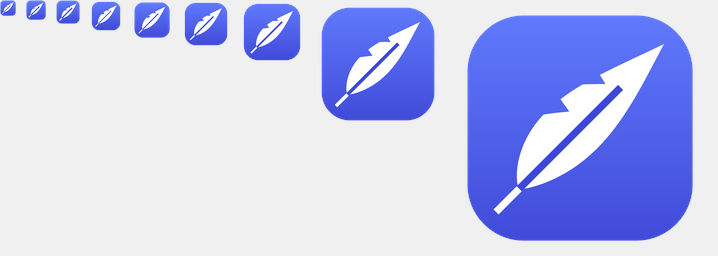

<p align="center"></p>

# Featherweight

**A light, fast PDF reader for Windows.** Zero bloat, zero subscriptions, zero cloud.

Featherweight opens PDFs instantly, fills in and saves forms, prints, and stays out of your way.
No account, no ads, no telemetry, no background services.

## Features

- **Read**: single page, continuous or two-page view, smooth zoom (Ctrl+scroll, pinch), rotate, clickable links
- **Fill in forms**: text fields, checkboxes, radio buttons, dropdowns and lists, including forms that use JavaScript for formatting and totals. Saves in place (Ctrl+S) or as a new file.
- **Print**: the normal Windows print dialog. Filled-in values are printed as sharp text.
- **Find**: Ctrl+F with every match highlighted
- **Tabs** for multiple documents. Opening a PDF from Explorer adds a tab to the running window.
- **Dark mode** that follows Windows, plus **night reading** (Ctrl+I), which turns the pages themselves dark
- **Full screen** (F11) and **presentation mode** (F5)
- Remembers the page, zoom and layout of every file you open
- **Updates itself** quietly from GitHub Releases, and the new version starts the next time you open it

## Install

Download the latest version from [Releases](https://github.com/dreamtheater484/featherweight/releases):

- **`Featherweight-x.y.z-Setup.exe`**: installs for your user account only, with no administrator rights needed. It adds a Start menu entry and can be uninstalled from Windows Settings.
- **`Featherweight-x.y.z-Portable.zip`**: unzip anywhere and run `Featherweight.exe`. Settings are stored next to it.

Requires Windows 10 (version 1903 or later) or Windows 11, 64-bit.

> Featherweight isn't code-signed yet, so Windows SmartScreen may warn the first time you run a downloaded copy.
> Choose **More info → Run anyway**. Updates installed by the app itself don't trigger this.

## Keyboard shortcuts

| Action | Keys |
|---|---|
| Open, Save, Save as, Print | Ctrl+O, Ctrl+S, Ctrl+Shift+S, Ctrl+P |
| Close tab, next/previous tab | Ctrl+W, Ctrl+Tab / Ctrl+Shift+Tab |
| Find, next/previous match | Ctrl+F, Enter / Shift+Enter (or F3 / Shift+F3) |
| Go to page | Ctrl+G |
| Next/previous page | Page Down / Page Up, Alt+→ / Alt+← |
| First/last page | Home / End |
| Zoom in/out | Ctrl+= / Ctrl+−, Ctrl+scroll |
| Automatic, actual size, fit page, fit width | Ctrl+0, Ctrl+1, Ctrl+2, Ctrl+3 |
| Single page, continuous, two pages | Ctrl+6, Ctrl+7, Ctrl+8 |
| Rotate right/left | Ctrl+Shift+= / Ctrl+Shift+− |
| Night reading | Ctrl+I |
| Full screen, presentation | F11, F5 (Esc to leave) |

## Privacy

Featherweight never sends your documents anywhere. Its only network access is a check of
`api.github.com` for a new release, at most once a day. You can turn off automatic updates in the ⋯ menu.
Links inside PDFs only open web pages and email (http, https, mailto). Links to files or programs are blocked.

## Building from source

Requirements: Visual Studio 2019 or 2022 with the C++ desktop workload (or the Build Tools), and CMake 3.21 or later.

```bash
cmake -S . -B build
cmake --build build --config Release
ctest --test-dir build -C Release
```

The first configure downloads the pinned PDFium build (checked against its SHA-256 hash).
To build without form JavaScript (smaller, 7.5 MB instead of 32 MB): `cmake -S . -B build -DFW_WITH_V8=OFF`.

Releases are built locally with `scripts/release.ps1`, which needs [Inno Setup 6](https://jrsoftware.org/isinfo.php).
See [IMPLEMENTATION_PLAN.md](IMPLEMENTATION_PLAN.md) for the design and [docs/TEST_CHECKLIST.md](docs/TEST_CHECKLIST.md) for release testing.

## License

MIT. See [LICENSE](LICENSE). Featherweight uses [PDFium](https://pdfium.googlesource.com/pdfium/); see
[THIRD_PARTY_NOTICES.md](THIRD_PARTY_NOTICES.md).
