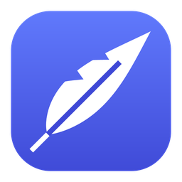
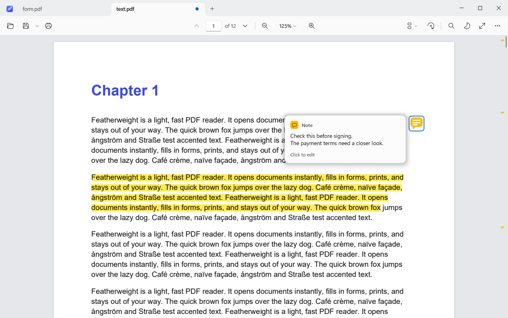
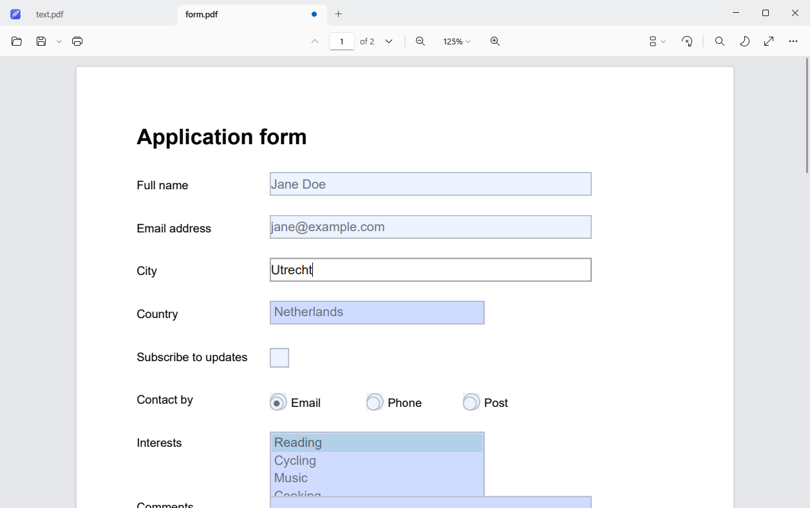
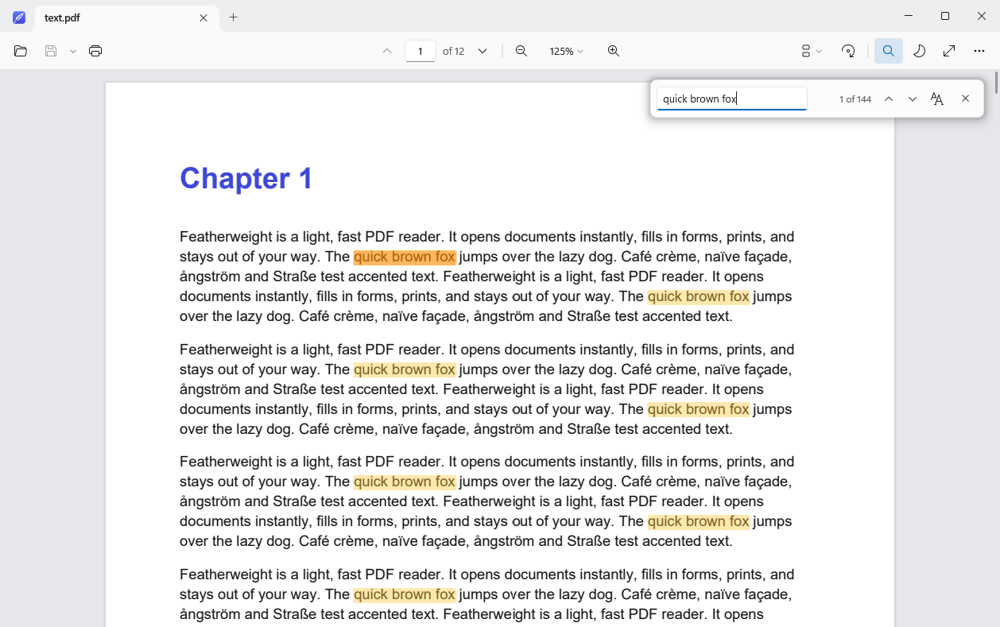
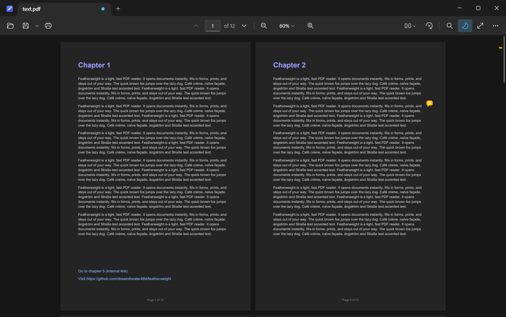
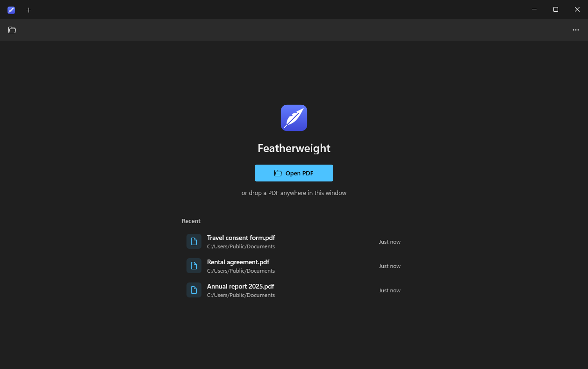

<p align="center">
  
</p>

<h1 align="center">Featherweight</h1>

<p align="center">
  <b>A light, fast PDF reader for Windows.</b><br>
  Zero bloat, zero subscriptions, zero cloud.
</p>

<p align="center">
  <a href="https://github.com/dreamtheater484/featherweight/releases/latest"></a>
  <a href="https://github.com/dreamtheater484/featherweight/releases"></a>
  
  <a href="LICENSE"></a>
</p>

<p align="center">
  <a href="https://github.com/dreamtheater484/featherweight/releases/latest"><b>⬇ Download for Windows</b></a>
</p>



Featherweight opens PDFs instantly, fills in and saves forms, lets you highlight and add notes, searches,
and prints. Then it stays out of your way. No account, no ads, no telemetry, no background services,
and a 0.7 MB program.

## What's new in 0.9.4

- **Note previews:** hover a note to read it in a clean card. Click to edit.
- **Note markers:** small amber marks along the right edge show where every note is. Click one to jump there.
- **New note icon:** a modern amber speech bubble that other PDF readers show too.
- Hovering a note no longer opens an old-style yellow popup.

See [all releases](https://github.com/dreamtheater484/featherweight/releases) for earlier changes.

## Features

**Read**
- Single page, continuous or two-page view, with optional book-style cover page
- Smooth zoom (Ctrl+scroll, touchpad pinch), fit width, fit page, rotate
- Clickable links. Web links open in your browser; links to files or programs are blocked for your safety.
- Remembers the page, zoom and layout of every file you open

**Fill in forms**
- Text fields, checkboxes, radio buttons, dropdowns and lists
- Forms that use JavaScript for formatting and totals work too
- Tab and Shift+Tab move between fields, across pages
- **Ctrl+S** saves in place. **Save as** is in the arrow next to the Save button (Ctrl+Shift+S).

**Highlight and add notes**
- Select text and a small bar appears. Click **Highlight**, or **Copy**.
- Right-click anywhere on a page → **Add note**. Hover a note to read it, and click to edit it.
- Amber markers along the right edge show where every note is in the document
- Saved as standard PDF annotations, so Adobe Reader, Edge and others show them too

**Find and print**
- **Ctrl+F**: every match is highlighted as you type, even in 600-page documents
- Printing uses the normal Windows print dialog. Filled-in form values are printed as sharp text.

**Comfortable**
- Tabs for multiple documents. Opening a PDF from Explorer adds a tab to the running window.
- Dark mode that follows Windows, plus **night reading** (Ctrl+I), which turns the pages themselves dark
- Full screen (F11) and presentation mode (F5)
- Updates itself quietly; the new version starts the next time you open it

| Fill in forms | Find in document |
|---|---|
|  |  |
| **Night reading, two pages** | **Start screen** |
|  |  |

## Install

Download from the [latest release](https://github.com/dreamtheater484/featherweight/releases/latest):

- **`Featherweight-x.y.z-Setup.exe`** installs for your user account only, with no administrator rights needed. It adds a Start menu entry and can be uninstalled from Windows Settings.
- **`Featherweight-x.y.z-Portable.zip`**: unzip anywhere (even a USB stick) and run `Featherweight.exe`. Settings are stored next to it.

Requires Windows 10 (version 1903 or later) or Windows 11, 64-bit.

> Featherweight isn't code-signed, so Windows SmartScreen may warn the first time you run a downloaded copy.
> Choose **More info → Run anyway**. Updates installed by the app itself don't trigger this.

## Keyboard shortcuts

| Action | Keys |
|---|---|
| Open, Save, Save as, Print | Ctrl+O, Ctrl+S, Ctrl+Shift+S, Ctrl+P |
| Close tab, next/previous tab | Ctrl+W, Ctrl+Tab / Ctrl+Shift+Tab |
| Find, next/previous match | Ctrl+F, Enter / Shift+Enter (or F3 / Shift+F3) |
| Copy selected text | Ctrl+C |
| Go to page | Ctrl+G |
| Next/previous page | Page Down / Page Up, Alt+→ / Alt+← |
| First/last page | Home / End |
| Zoom in/out | Ctrl+= / Ctrl+−, Ctrl+scroll |
| Automatic, actual size, fit page, fit width | Ctrl+0, Ctrl+1, Ctrl+2, Ctrl+3 |
| Single page, continuous, two pages | Ctrl+6, Ctrl+7, Ctrl+8 |
| Rotate right/left | Ctrl+Shift+= / Ctrl+Shift+− |
| Night reading | Ctrl+I |
| Full screen, presentation | F11, F5 (Esc to leave) |
| Save or close a note | Ctrl+Enter, Esc |

## Privacy

Featherweight never sends your documents anywhere. Its only network access is a check of
`api.github.com` for a new release, at most once a day. You can turn off automatic updates in the ⋯ menu.

## Building from source

Requirements: Visual Studio 2019 or 2022 with the C++ desktop workload (or the Build Tools), and CMake 3.21 or later.

```bash
cmake -S . -B build
cmake --build build --config Release
ctest --test-dir build -C Release
```

The first configure downloads the pinned PDFium build and checks it against its SHA-256 hash.
To build without form JavaScript (7.5 MB engine instead of 32 MB): `cmake -S . -B build -DFW_WITH_V8=OFF`.

- `tests\visual-checks.ps1` renders every important screen to `build\visual\` for review.
- `scripts\release.ps1` builds the installer (needs [Inno Setup 6](https://jrsoftware.org/isinfo.php)), the portable zip and checksums, and publishes a release.
- The design is described in [IMPLEMENTATION_PLAN.md](IMPLEMENTATION_PLAN.md), and release testing in [docs/TEST_CHECKLIST.md](docs/TEST_CHECKLIST.md).

## License

MIT. See [LICENSE](LICENSE). Featherweight uses [PDFium](https://pdfium.googlesource.com/pdfium/); see
[THIRD_PARTY_NOTICES.md](THIRD_PARTY_NOTICES.md).
